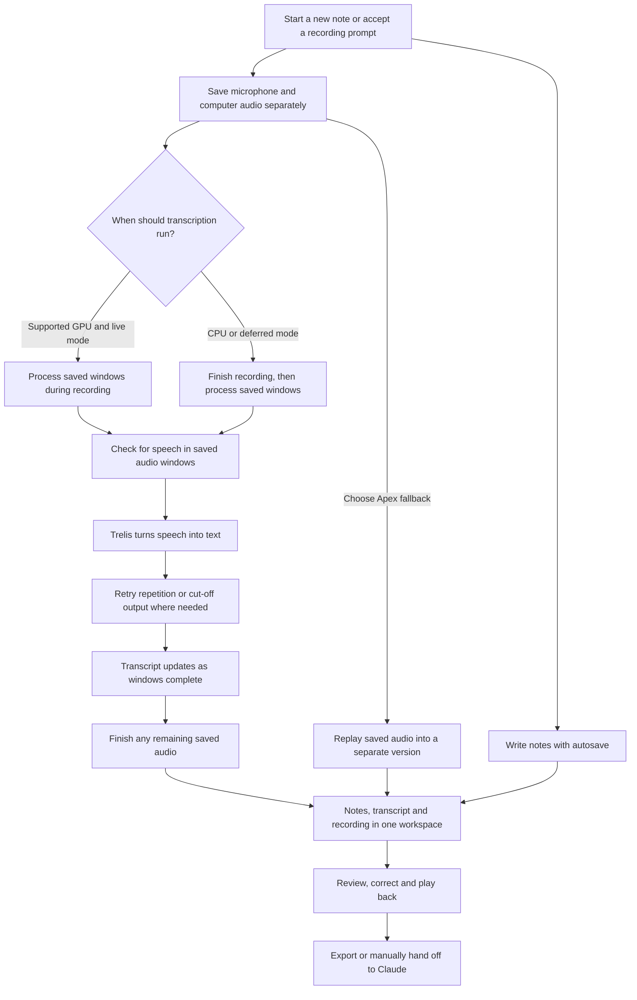

# oats

**Local meeting transcription and dictation for Hindi–English conversations.**

Record a call and take notes, or speak into the app where you are already writing. oats runs speech recognition on your Windows PC and keeps your recordings, notes and transcripts locally.

*I listen and I don't judge.*

**[Download for Windows](https://github.com/Ripplescale/Oats_Transcription_Platform/releases/download/setup-90c87eedfa370799c4de/Oats-Setup.exe)** · [Installation guide](docs/COMPLETE_SETUP.md) · [Releases](https://github.com/Ripplescale/Oats_Transcription_Platform/releases) · [How it works](docs/HOW_IT_WORKS.md)

*Screenshots use fictional conversations and notes.*

**Explore:** [Transcription](#meeting-transcription) · [Dictation](#dictation-into-another-app) · [Notes and organisation](#notes-and-organisation) · [Install and update](#install-and-update)

## Two ways to use oats

| | Meeting transcription | Dictation |
| --- | --- | --- |
| Use it for | Calls, interviews, discussions and meeting notes | Writing messages, emails and documents by speaking |
| Audio input | Your microphone and computer audio, saved as separate tracks | Your default Windows microphone |
| Text destination | A saved transcript alongside your notes and recording | The focused text field in another app |
| Start | **New note**, or accept a Zoom/Teams recording prompt | **Ctrl + Alt + Shift + D**, or a supported Copilot key |
| Model | Trelis, with an optional separate Apex fallback | Trelis |
| What is kept | Audio, notes, transcript versions and corrections | The last result remains available in Settings; no meeting is created |

## Meeting transcription

### Record and take notes

- **Capture both sides of a call.** Microphone and computer audio are recorded separately, with timing information for playback and recovery.
- **Write while recording.** Notes autosave independently of transcription. You can return to Home and browse other notes while a meeting continues recording.
- **Choose when to transcribe.** A compatible Intel GPU supports Trelis updates during recording. CPU mode prepares the Trelis transcript after you finish recording; deferred processing is also available.
- **Choose a processing window.** Trelis supports 5, 10 or 20-second windows, with 10 seconds as the default for new settings. Loading, inference and queued work add delay beyond that window length.
- **Start from a call prompt.** Supported Zoom and Teams desktop activity can show **Record call / Dismiss**. You decide whether to record; oats does not automatically join or record a meeting. [Detection coverage](docs/MEETING_DETECTION.md).

### Review and reuse the conversation

- **Read Hindi and English together.** Trelis preserves mixed Hindi/English scripts. Microphone and computer-audio bubbles identify recording sources, not individual people.
- **Listen and correct.** Keep playback, original recognition and your corrections together. A correction does not erase the original model output.
- **Retry saved audio.** If recognition fails, retry the saved recording without asking everyone to repeat the call. Suspicious repetition and length-limited output can trigger bounded retries using surrounding audio or shorter pieces.
- **Compare a fallback version.** Choose **Apex fallback** to reprocess saved audio into a separate Roman Hinglish transcript. Trelis output and its corrections remain available.
- **Export or hand off.** Export TXT, Markdown or JSON, or prepare a transcript for Claude. You choose when to copy, attach and send it; oats does not automatically submit a summary request.
- **Optionally review speakers.** Separately configured Community-1 speaker identification runs after a saved transcript is ready. It is not live speaker recognition and is not included in the complete setup.

### How transcription works

**Audio is saved before recognition.** Recording continues independently of model loading or transcription. In live mode, finishing the recording lets the same Trelis job process its remaining audio; it does not start a second full pass. Other transcription work can queue, and CPU meeting transcription waits until capture finishes.

The speech checks include a conservative speech detector and a quiet-microphone policy. Very quiet microphone speech can be omitted from the transcript, while the source audio is retained. Automatic checks and retries help with review; they do not establish that every word is correct. See the [detailed processing flow](docs/HOW_IT_WORKS.md#how-each-piece-of-audio-becomes-text).

## Dictation into another app

1. Keep oats running, including in the system tray.
2. Click the text field where you want to write.
3. Press **Ctrl + Alt + Shift + D** and speak.
4. Confirmed text is typed into that field while dictation continues. Press the shortcut again, or **Stop**, to finish the remaining words.

The **Copilot key** can use the same toggle when it emits the supported **Win + Shift + F23** signal. Check **Settings → Dictation** for shortcut availability; use the fallback shortcut if your laptop or Windows configuration does not support the Copilot key.

### What to expect

- **A movable slim pill.** The floating indicator shows microphone activity, status, Stop and Cancel. Drag its grip to move it; oats remembers the position.
- **Confirmed words, with a delay.** The Trelis worker compares successive recognition results and types words that agree. Tentative trailing words stay pending; pauses and Stop help finish the tail. This is not instant, guaranteed word-by-word output.
- **Focus stays with you.** Moving the mouse or dragging the indicator does not alone interrupt insertion. Changing apps or text fields, clicking to move the caret, or editing with the keyboard can stop automatic typing to protect the destination. oats does not follow you across tabs or force focus back.
- **A copy fallback.** If insertion is interrupted or unavailable, the result remains available to review and copy. Words already typed are kept. Starting dictation from Settings produces a result to copy rather than typing into another app.
- **Local model reuse.** The model can prepare while speech work is idle and be reused across dictations. Cold starts and CPU mode can still be slow. Finish meeting recording and local speech processing before starting dictation.

Dictation uses the default microphone and is limited to two minutes per session. It does not create a saved meeting. See the [dictation guide](docs/DICTATION.md) for input safeguards, model lifecycle and compatibility details.

## Notes and organisation

| Feature | What you can do |
| --- | --- |
| Projects and folders | Group meetings and notes, move them between projects, and browse your library |
| Tags and search | Tag notes and filter within a folder; search titles, note previews and tags |
| Rich notes | Use bold, italic, underline, strikethrough, highlighting, links, headings, lists, quotes and horizontal rules |
| Editable titles | Rename a meeting directly from its notes page, including after recording has finished |
| Project memory | Find source-linked excerpts from saved notes and project references |
| Optional project Vault | Keep verified names, terms, quantities and their supporting sources; entries do not silently rewrite transcripts |
| User / Dev views | Use the uncluttered User view or expose processing diagnostics in Dev view |
| Saved-audio recovery | Recover interrupted recordings, retry recognition, or explicitly delete recovery audio while keeping saved notes and text |

See the notes library

## Install and update

### First installation

Download **[Oats-Setup.exe](https://github.com/Ripplescale/Oats_Transcription_Platform/releases/download/setup-90c87eedfa370799c4de/Oats-Setup.exe)**, open it and click **Install oats**. It downloads the app and speech dependencies from GitHub. No Python installation, terminal commands or account setup are needed for the core workflow.

| Requirement | Guidance |
| --- | --- |
| Operating system | Windows x64; Windows 11 recommended. The published installer does not support Windows ARM or macOS |
| Memory | At least 16 GB RAM; 32 GB recommended for live Trelis transcription |
| Free disk space | Keep about 30 GB free for download and setup |
| Initial download | About 11 GB, including the speech models and runtime |
| Live Trelis processing | A compatible Intel GPU and current driver; CPU mode works after meeting recording and can be slow for dictation |

Once setup is complete, recording and speech recognition can run without internet. To prepare another PC without internet, choose **Download for another PC** and transfer the whole download folder. See the [short installation guide](docs/COMPLETE_SETUP.md) for both cases.

### Already installed?

Use the app's update notification or **About → Check for updates**. Update checks run automatically; you choose when to download and install. The smaller app update reuses prepared speech models and keeps local work. Fully quit other oats copies before installing an update.

If a download is interrupted, reopen setup and choose the same download folder. If a meeting says **Transcription needs attention**, update oats, open **Tools → Transcription & versions**, and retry the saved audio. [Setup and repair help](docs/COMPLETE_SETUP.md#if-transcription-says-needs-attention).

## Privacy and practical limits

- **Speech recognition runs locally.** Recordings are not automatically sent to a transcription or summary API. Setup and update checks/downloads use the network; any content you send through Claude or an exported file is your choice.
- **Local does not mean encrypted by oats.** Protection depends on Windows permissions, device encryption and your backup settings. Read the [privacy policy](PRIVACY_POLICY.md) for storage and retention details.
- **Review important details.** Names, numbers, units, overlap and quiet speech can be wrong. A completed transcript means processing finished, not that a person verified it.
- **Hardware affects timing.** Startup, model loading, retries and queued jobs add delay. Performance on one development laptop is not a guarantee for another PC or a long call. [Measurements and validation limits](docs/HOW_IT_WORKS.md#models-and-timing).
- **Some integrations are outside the current release.** Outlook calendar sync, automatic meeting recaps, live individual speaker identification, screen video and shared workspaces are not enabled.
- **Managed PCs have their own policies.** The app uses signed updater artifacts, but corporate endpoint-security acceptance is separate from download/signature verification.

## Documentation and development

| Guide | Contents |
| --- | --- |
| [Install oats](docs/COMPLETE_SETUP.md) | Download, requirements, offline transfer, updates and repair |
| [How it works](docs/HOW_IT_WORKS.md) | Capture, transcription windows, retries, versions, speakers and storage |
| [Dictation](docs/DICTATION.md) | Shortcuts, live delivery, focus rules and local model lifecycle |
| [Meeting detection](docs/MEETING_DETECTION.md) | Zoom/Teams prompts and detection limits |
| [Developer setup](docs/DEVELOPER_SETUP.md) | Building and running from source |
| [Contributing](CONTRIBUTING.md) | Contribution workflow and checks |
| [Speech runtime](stt_lab/README.md) | Local model and worker tooling |
| [Releases](https://github.com/Ripplescale/Oats_Transcription_Platform/releases) | Published installers, signatures and release notes |

oats uses **Tauri/Rust**, **Next.js/React**, **SQLite** and local **Python** speech workers. The app was previously named xx; its existing `com.sttapp.local` identity and `STTApp` data directory are retained for upgrade continuity. Private recordings, credentials and model weights are not committed to the source repository; redistributable model bundles are hosted as GitHub release assets.

## Attribution

Based on [Meetily Community](https://github.com/Zackriya-Solutions/meetily), pinned at `a2cb62e827da7ef59f65064c97233efb2313878e` (`v0.4.1`). The upstream **Copyright (c) 2024 Zackriya Solutions** and [MIT license](LICENSE.md) are preserved. This fork is independent of Meetily's commercial product. Model and runtime licenses are separate; see [third-party attribution](docs/ATTRIBUTION.md).
